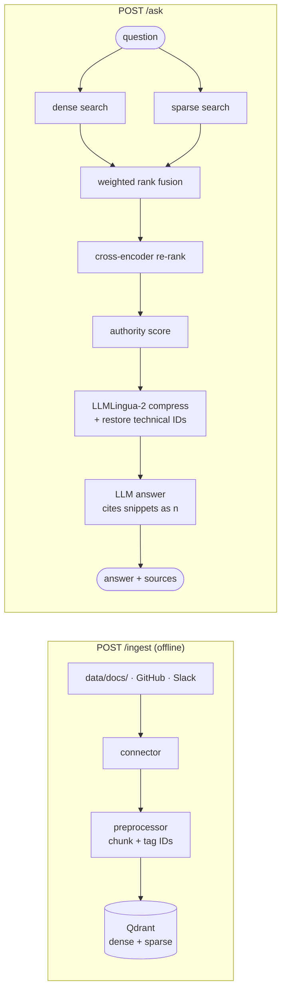

# incident-rag

Ask why something failed, in plain English, and get a short answer written from postmortems, runbooks,
technical docs, PRs/commits and chat threads, with every claim citing the document it came from.

```text
$ uv run ask "<your question>"
<2-5 sentences written from your documents, each claim citing a snippet> [1][2].

Sources:
  [1] <source_uri of the first document>
  [2] <source_uri of the second document>
```

The documents it answers from are listed in [Documents](#documents).

## How it works



| Step | File | What it does |
|---|---|---|
| Dense search | `dense.py`, `embeddings.py` | Gemini `gemini-embedding-001` (768-dim) embedding, cosine search in Qdrant |
| Sparse search | `sparse.py` | Hashed term frequencies: exact words such as error codes and host names |
| Fusion | `fusion.py` | Weighted reciprocal rank fusion (k=60); more weight on sparse when the question has IDs |
| Re-rank | `reranker.py` | Cross-encoder `ms-marco-MiniLM-L-6-v2` scores each (question, chunk) pair |
| Authority | `authority.py` | `sigmoid(score)` × 1.25 for tier A (postmortems, runbooks, docs, merged PRs) × recency (halves per year of age, never below 0.5) |
| Compression | `compactor.py`, `id_preservation.py` | LLMLingua-2 shrinks each chunk; IDs like `db-primary:5432` are put back if dropped |
| Answer | `answer.py` | LLM writes 2-5 sentences from the numbered snippets only; code drops citations to snippets that don't exist |

**Design choices**
- **The LLM only writes the text.** Which documents were found, and which citations are valid, is decided in
  code, so an answer can't cite a document that wasn't retrieved.
- **One API for everything that needs a model call.** Embeddings and answer both go to one
  OpenAI-compatible endpoint (Gemini by default). The re-ranker and compression models run locally on CPU.
- **No conflict resolution.** Every document is about the one service under test, so there is no step that
  judges documents against each other; authority and recency scoring decide which ones come first.
- **It degrades instead of failing.** No relevant documents → it says so without calling the LLM. No API key,
  or the LLM call fails → it returns the top document as the answer, marked "No LLM answer was generated".
- **It answers from documents only.** It does not read live logs or metrics, so it tells you what the
  runbooks say about a failure like yours, not what actually happened in your system.

## Documents

Qdrant holds documents about **one service: the service under test**. Right now that's the payment service of
the [OpenTelemetry Demo](https://github.com/open-telemetry/opentelemetry-demo). Nothing about other services is
indexed. To switch service, edit `data/sources.yaml`, empty Qdrant, and ingest again.

| Type (`source_type`) | What | Where it comes from | Ingest with |
|---|---|---|---|
| `postmortem` | Incident postmortems | Written by you after each incident of the service, in the format below | `local_file` (`data/docs/postmortems/`) |
| `runbook` | Runbooks | The service's own runbooks (`runbooks:` in `data/sources.yaml`), or yours in `data/docs/runbooks/` | `github`, `local_file` |
| `doc` | Technical documentation | The service's official docs (`docs:` in `data/sources.yaml`), or yours in `data/docs/technical/` | `github`, `local_file` |
| `github` | PRs and commits | The latest 50 commits touching the service's folder (`code:`); squash-merged ones are stored as their PR; bot and merge commits skipped | `github` |
| `slack` | Engineering discussions | Threads from the service's channels in `SLACK_CHANNELS` | `slack` |

```text
data/
  sources.yaml          # the service under test: repo + path for code / runbooks / docs (a path is a file or folder)
  docs/                 # the local_file connector; the folder sets the type (front matter source_type overrides it)
    postmortems/        # → postmortem
    runbooks/           # → runbook
    technical/          # → doc (also any file directly in data/docs/)
```

**Format and chunking per type** (`src/documents.py`). Each fetched document is parsed into a Pydantic model
for its type. A document that doesn't fit the format (e.g. a postmortem without a root cause) is skipped,
logged and counted in `documents_skipped`. Each model then chunks itself the way that type is read:

| Type | Model | Chunks |
|---|---|---|
| `postmortem` | `Postmortem` | 4, by question: what happened, timeline, why it happened, how it was fixed |
| `runbook` | `Runbook` | one per section, so a step is never cut in half |
| `doc` | `TechDoc` | short sections packed together up to 512 words, each with its heading |
| `github` | `CodeChange` | one: the PR or commit title and description |
| `slack` | `SlackThread` | 10 messages per chunk, overlapping by 2 |

Every chunk starts with its document's title; text longer than 512 words is split into overlapping windows.

**Metadata.** Each chunk's text starts with a header line that is embedded with it, e.g.
`[postmortem · payment · 2026-10-17 · Why it happened]` or `[pr · payment · 2026-07-09]`. The Qdrant payload holds:

| Field | On | Meaning |
|---|---|---|
| `service` | every chunk | the service under test (`SERVICE_NAME`, default `payment`) |
| `source_type`, `title`, `section`, `chunk_index` | every chunk | document type, its title, which part of it the chunk is, position |
| `source_uri`, `doc_id`, `chunk_id`, `authority_tier` | every chunk | citation link, ids, A/B trust tier |
| `created_at` | every chunk | the date that matters: incident date, PR merge / commit date, else last update; drives recency |
| `incident_date`, `severity` | postmortem | from the front matter |
| `kind`, `ref`, `author`, `changed_on` | github | `pr` or `commit`, PR number or SHA, who, when |
| `channel`, `message_count`, `last_message_on` | slack | where and how long the thread is |

Re-running an ingest only fetches what changed since the last run. A source without its settings (no
`data/sources.yaml`, no `SLACK_BOT_TOKEN`) fetches nothing.

**Postmortem record format.** Every file in `data/docs/postmortems/` uses the same front matter and sections:

```markdown
---
doc_id: pm-2026-10-17-payment-charge-failures
source_type: postmortem
title: Payment charges failing for half of checkouts
service: payment
incident_date: 2026-10-17
severity: major
source_uri: postmortems/2026-10-17-payment-charge-failures.md
authority_tier: A
---
## Summary
## Impact
## Timeline
## Root cause
## Trigger
## Detection
## Resolution
## Lessons and action items
## Sources
```

## Run it

Needs Docker and a free [Gemini API key](https://aistudio.google.com/apikey). One key is used for the embeddings
and the answer (any OpenAI-compatible provider works: set `LLM_BASE_URL`).

```bash
uv sync
cp .env.example .env                  # put your key in LLM_API_KEY
docker compose up -d qdrant
uv run uvicorn src.main:app --port 8002          # first start downloads the local re-rank/compression models
for source in local_file github slack; do       # see Documents above
  curl -X POST localhost:8002/ingest -H 'Content-Type: application/json' -d "{\"source_type\": \"$source\"}"
done
uv run ask "why are checkouts failing with payment errors?"
```

| Endpoint | Purpose |
|---|---|
| `POST /ask` `{question, max_chunks=5}` | Answer with numbered sources and the chunks used |
| `POST /knowledge` | The retrieved, compressed chunks only (no answer) |
| `POST /ingest` `{source_type, full_reindex=false}` | Fetch one source (`local_file`, `github`, `slack`) into Qdrant |
| `GET /health` | Liveness |

## Tests

```bash
uv run pytest            # unit + integration tests (models and services mocked)
```

## Evaluation (RAGAS)

`eval/questions.jsonl` holds questions about the payment service, each with a reference answer written from the
indexed documents. `eval/run_ragas.py` asks the running service each question and scores the answer with
[RAGAS](https://docs.ragas.io), using an LLM as the judge (`EVAL_LLM_MODEL`):

| Metric | Question it answers |
|---|---|
| faithfulness | Is every claim in the answer supported by the retrieved chunks? (catches made-up answers) |
| answer_relevancy | Does the answer address the question? |
| context_precision | Are the chunks that matter ranked above the ones that don't? |
| context_recall | Did retrieval find everything the reference answer needs? |

```bash
uv run uvicorn src.main:app --port 8002            # in one terminal (Qdrant must be up and ingested)
uv run --group eval python eval/run_ragas.py       # in another; writes eval/results.md
```

On Gemini's free tier the judge is limited to a few requests per minute, so a run takes several minutes; the script
waits and retries when it hits the limit.
